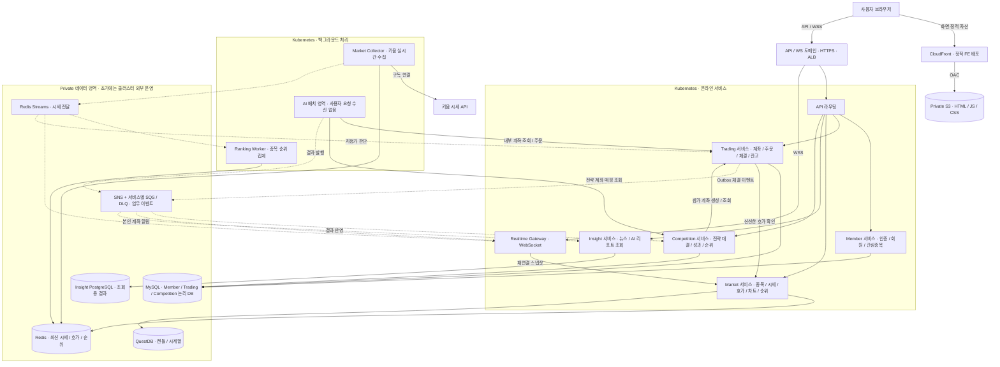
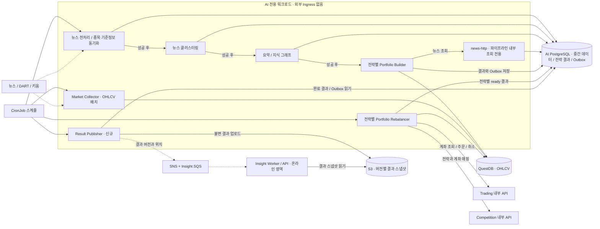

# Stock Spoon MSA 목표 아키텍처

2026-10-12 · 로컬 BE/FE/AI 코드와 추가 기능을 바탕으로 한 설계 제안. 현재 배포 상태를 나타내는 문서가 아니다.

전제: 현재 코드의 모의투자 체결 모델을 유지한다. 사용자 직접 매매, 관심종목, 실시간 시세·호가·종목 순위, 전략별 AI 대결을 포함한다. 실제 증권 주문 송신·결제·정산은 범위에 포함하지 않는다. “토스증권의 거의 모든 기능” 중 구체적으로 열거되지 않은 기능은 별도 요구사항 확정이 필요하다.

## 1. 전체 서비스 구조

실선은 요청·조회·저장, 점선은 비동기 데이터 전달이다. 요청 화살표의 응답은 생략했다. AI 영역에는 사용자 요청 경로가 없다.

API 라우팅은 ALB/Gateway 라우트 설정으로 구현 가능하며 별도 Spring Gateway 애플리케이션을 필수로 두지 않는다. EKS를 AWS 환경의 후보로 두되 특정 Kubernetes 배포판은 확정하지 않는다. CSR 화면은 CloudFront + private S3에서 정적 배포하며 FE Deployment는 기본 구성에서 제외한다. 브라우저가 API와 WebSocket을 직접 호출한다. SSR이 실제 필요한 페이지가 생기면 해당 경로만 별도 Next.js 런타임으로 추가한다.

### FE 정적 배포 전환 조건

현재 FE는 next.config.ts의 output이 standalone이며 src/proxy.ts에서 요청 로그를 기록한다. next/image 사용과 /ai/trades/[orderId] 동적 경로도 있으므로 현재 빌드 산출물을 그대로 S3에 올릴 수 있다고 보장하지 않는다.

- 정적 배포용 output: export 전환과 실제 export 빌드 검증이 필요하다.
- proxy.ts의 서버 요청 로깅은 CloudFront 접근 로그 등으로 대체한다.
- next/image의 기본 서버 최적화 대신 unoptimized 또는 외부 이미지 로더를 적용한다.
- 빌드 시 열거할 수 없는 주문 ID 경로는 고정 페이지와 쿼리 파라미터 등 정적 export 가능한 구조로 바꾼다. 단순 index.html 오류 fallback으로 Next 동적 라우트 문제가 해결된다고 가정하지 않는다.
- S3 REST origin + OAC로 버킷을 비공개 유지한다. 화면 경로는 실제 export 결과의 HTML 경로에 맞춰 rewrite하고 딥링크 새로고침을 검증한다.
- 웹/API 도메인을 분리하는 기본안에서는 정확한 CORS origin, credentials, 쿠키 Domain/SameSite/Secure, CSRF, WebSocket Origin 검증을 구성한다. 동일 도메인이 필요하면 CloudFront의 /api/* origin을 ALB로 분기할 수 있으며 인증·개인화 응답은 캐시하지 않는다.
- 해시 자산은 장기 캐시, HTML은 짧은 캐시/재검증을 적용하고 배포·롤백 시 기존 자산을 유지한다. 실시간 금융 데이터는 정적 FE 캐시와 별도다.

## 2. AI 실행 구조

화살표의 “성공 후”는 실행 의존성을 나타낸다. 서로 다른 CronJob의 예약 시각 차이로 순서를 보장하지 않는다. 초기에는 기존 순차 스크립트를 하나의 파이프라인 Job으로 감싸고, 필요 시 워크플로 실행기로 단계별 Job을 관리한다. 시장 기준정보·뉴스·가격의 준비 여부와 데이터 기준 시각도 실행 전 확인한다.

현재 AI의 news-http는 읽기 서버지만 사용자 요청에서 호출하면 AI 가용성이 온라인 응답에 영향을 준다. 목표안에서는 news-http를 AI 내부 도구로 유지하고 사용자 조회는 Insight로 이전한다. 기존 BE가 이를 이미 호출한다고 전제하지 않는다.

Result Publisher는 신규 구성이다. 뉴스·그래프·포트폴리오 결과를 버전별로 발행하며 큰 결과는 S3에 저장하고 이벤트에는 위치·버전·체크섬만 넣는다. Insight가 검증·반영을 완료한 버전만 공개한다. 이벤트 중복은 결과 ID·버전으로 제거하고, 발행 실패는 Outbox에서 재시도한다. AI 장애 시 최신 성공 결과와 생성 시각을 계속 제공한다.

## 3. 서비스별 데이터 소유권

| 서비스 | 소유 데이터 | 배포 형태 |
|---|---|---|
| Member | 회원, OAuth, 인증 토큰 상태, 관심종목 | Deployment |
| Trading | 계좌, 현금, 보유량, 주문, 체결, 주문 판단 근거, Outbox, 멱등성 기록 | API Deployment와 시세 소비 Worker; 같은 서비스 경계 |
| Market | 종목 기준정보의 조회 모델, 최신 호가·시세, 차트 조회 | API Deployment와 수집 Worker |
| Ranking | 거래대금·거래량·등락률 등 종목 순위의 조회 모델 | Market 영역 Worker |
| Realtime | 연결·구독 상태, 전달 커서; 거래 원장 소유 없음 | Deployment |
| Insight | 공개된 뉴스·그래프·전략·리포트의 조회 모델 | API/Consumer Deployment |
| Competition | 대회, 전략 버전, 참가자, 전략-계좌 연결, 평가 시점, 성과 스냅샷 | API/집계 Worker |
| AI | 뉴스 처리 중간 데이터, 전략별 포트폴리오, 추론 기록, 실행 상태 | CronJob / Job, 내부 news-http Deployment |

MySQL은 초기 비용을 위해 물리 인스턴스를 공유할 수 있지만 서비스별 논리 DB·계정을 분리하고 타 서비스 테이블 직접 조회와 FK를 제거한다. Trading은 account/order/holding/execution의 단일 트랜잭션과 계좌 잠금을 유지한다. Member 분리 시 기존 Account→User JPA 연관을 userId 참조로 전환하며 온보딩·탈퇴의 단계별 처리도 필요하다.

AI 내부 작업끼리 공유하는 PostgreSQL은 하나의 AI 데이터 도메인으로 인정한다. Insight DB는 AI DB와 논리적으로 분리한다. QuestDB는 기존 AI OHLCV 저장을 유지하면서 Market 조회 계정은 읽기 전용으로 제한하는 초기 예외를 둔다. 장기적으로 수집·보관 소유권을 Market으로 옮길 수 있다.

## 4. 실시간·거래 전달 규칙

- 사용자 화면 구독과 미체결 주문 구독을 합쳐 수집 수요를 만든다. Market 내부 구독 API로 등록하고 TTL/heartbeat, 미체결 주문 재조정으로 복구한다. 전체도에는 이 제어 경로를 생략했다.
- 실시간 수집기는 공급자 연결/종목 할당 단위로 하나의 활성 소유자를 둔다. replica=1만으로 롤링 배포 중 중복 실행을 방지했다고 간주하지 않는다. lease·fencing과 재연결·재구독을 설계한다. 실제 공급자 연결 및 구독 한도는 별도 확인한다.
- Redis 최신 스냅샷은 화면·주문 조회용, Streams는 제한된 보존 기간의 시세 전달용이다. 대량 시세와 업무 이벤트의 브로커를 분리한다. 틱 저장은 전량 영구 보관을 기본으로 하지 않는다.
- Streams를 여러 Gateway가 하나의 consumer group으로 소비하면 메시지가 분산되어 필요한 클라이언트에 누락된다. Gateway별 전달 또는 종목별 라우팅으로 각 구독자에게 전달한다. Trading과 Ranking도 독립 소비 경계를 둔다.
- 클라이언트에는 순번·기준 시각을 전달한다. 화면 갱신은 묶어서 보내되 거래 판단 경로와 분리한다. 재연결·순번 누락 시 스냅샷을 다시 받는다.
- 시장가는 신선한 호가를 확인한 뒤 Trading DB 트랜잭션에서 체결한다. 오래된 호가나 수집 장애에서는 주문을 거절/보류하는 명시적 정책을 둔다. 현재 코드의 5초 검사 정책을 분리 후에도 보존하고 목표 지연에 맞춰 조정한다.
- 주문 요청에 clientOrderId/idempotencyKey를 넣고 계좌별 유일성을 DB에서 보장한다. 동일 키·동일 요청은 기존 결과를 반환하고 동일 키·다른 내용은 거절한다. 체결 이벤트는 거래 트랜잭션의 Outbox에서 발행한다.
- 시세 재생으로 지정가를 과거 가격에 체결하지 않도록 주문 생성 시각·수신 시각·순번과 복구 정책을 검증한다. 유실 구간의 기회를 재현할 수 없으면 그 한계를 명시하고 최신 시세부터 재개한다.
- 체결 알림과 대회 집계는 SNS에서 서비스별 SQS로 분기한다. SQS 하나를 여러 도메인이 경쟁 소비하지 않는다. Realtime 소비자는 계좌 연결을 가진 Gateway로 추가 전달해야 한다.
- 종목 순위는 Market 영역이고 전략 대회 순위는 Competition 영역이다. 인기 조회 순위가 필요하면 사용자 활동 이벤트 수집·중복 방지 규칙을 별도로 추가한다.

## 5. 전략 대결

AI는 전략별 투자 판단을 생성하고 BE는 대회와 계좌·체결·평가를 관리한다. 같은 실제 계좌를 공유하지 않고 같은 초기 자금과 거래 규칙을 가진 독립 모의 계좌를 만든다.

필수 식별자: competitionId, strategyId, strategyVersion, accountId, portfolioId, runId, dataAsOf, valuationAsOf.

현재 AI의 전체 최신 포트폴리오 조회를 전략별 최신 ready 결과 조회로 바꾸며, 리밸런서는 해당 전략에 배정된 계좌만 처리한다. 기존 대기 주문 일괄 취소도 전략·계좌 범위로 제한한다. 뉴스·그래프의 공통 전처리는 한 번 실행하고 Builder만 전략별로 실행한다.

평가 시점, 시세 스냅샷, 초기 자금, 거래 가능 종목, 수수료, 슬리피지, 포지션 제한을 동일하게 적용한다. 미실현 손익도 반영하므로 체결 이벤트만으로 순위를 계산하지 않는다. Competition 집계 Worker가 주기적으로 Trading 잔고와 Market 가격을 같은 기준 시점으로 조합하고 이벤트 유실에 대비해 원장과 재조정한다.

## 6. Kubernetes와 운영

- Public subnet: 인터넷 진입 ALB. Private subnet: Kubernetes 워크로드. 별도 private 데이터 영역: DB·Redis·메시징 접근. 외부 키움·뉴스·LLM 호출은 egress 경로를 사용한다.
- AI namespace에는 public Ingress와 사용자 API 라우팅이 없다. NetworkPolicy로 AI 내부 통신, 지정된 DB, 외부 제공자, Trading/Competition 내부 API만 허용한다. namespace만으로 격리되지는 않으므로 이를 지원하는 네트워크 구현이 필요하다.
- Member/Trading/Market/Insight/Competition API는 각자 권한 검증을 수행한다. 내부 AI 주문은 서비스 신원과 계좌별 위임 권한을 사용한다. 기존 사용자 JWT 서명 비밀을 AI가 공유하는 방식은 전환 대상이다.
- API는 요청량·지연·CPU, Realtime은 연결 수·전송량, Worker는 소비 지연을 관측한다. 지표 연결 후 HPA를 적용하며 모든 서비스의 초기 Pod 수를 일괄 지정하지 않는다.
- 장기 WebSocket 연결은 배포 시 drain하고 클라이언트가 재연결·구독 복구하도록 한다. readiness/startup/liveness, 종료 유예, 자원 requests/limits, 필요한 서비스의 PDB를 설정한다.
- AI Job은 리소스를 온라인 서비스와 분리하고 DB 연결 수·LLM 동시성·공급자 rate limit을 제한한다. CronJob은 Asia/Seoul, 중첩 정책, 실행 제한 시간, 재시도와 멱등성을 함께 설정한다. Forbid는 서로 다른 CronJob의 중첩을 막지 않는다.
- BE/AI는 GitHub Actions → 테스트/이미지 빌드 → ECR → 배포 매니페스트 갱신 → GitOps 배포를 목표로 한다. FE는 정적 export → S3 업로드 → HTML 캐시 갱신으로 별도 배포한다. DB 마이그레이션은 별도 Job이며 애플리케이션과 호환되는 순서로 실행한다.
- 로그·메트릭·트레이스를 중앙 수집한다. 핵심 알림은 시세 지연, 외부 연결 끊김, 주문 오류/중복, DB 잠금, 큐 지연/DLQ, AI 실행 실패/결과 노후화다. 도구는 기존 CloudWatch를 활용하고 필요에 따라 Prometheus/Grafana/OpenTelemetry를 추가한다.
- Secret 관리와 서비스별 최소 권한, DB 백업·복구 검증은 공통 운영 구성이다. 구체 노드 수·DB 사양·보존 기간은 부하 측정 후 확정한다.

## 7. 단계별 전환

1. 기존 BE의 거래 트랜잭션을 유지하고 AI 배치를 Kubernetes Job 형태로 이전한다. 온라인 요청은 AI 배치를 호출하지 않는다.
2. Market 수집·공유 경로를 추출하고 메모리 시세 의존을 제거한 뒤 BE/API 다중 Pod를 검증한다.
3. Realtime Gateway, 종목 순위 Worker, 사용자 직접 주문 정책을 추가한다.
4. Member/Trading 경계와 DB 소유권을 분리하고 AI 결과 발행·Insight 조회 모델을 도입한다.
5. 전략별 Builder/Rebalancer와 Competition을 추가한다. 대회 계좌 생성은 멱등하게 처리하고 부분 실패에서 복구한다.

## 근거

- BE OrderSubscriptionService: 단일 인스턴스 전제와 메모리 구독 수요.
- BE OrderExecutionService / AccountRepository: 계좌 비관적 잠금과 단일 트랜잭션 모의 체결.
- BE OrderController: AI 전용 주문 인증, 시장가/지정가 경로.
- FE useRankingQuery: 5초 폴링, stock API: 관심종목/순위 호출.
- AI compose.prod.yaml / systemd / run-morning-pipeline.sh: 배치 실행 및 단계 의존성.
- AI portfolio_rebalancer/portfolio.py: 전체 최신 포트폴리오 조회.
- AI portfolio_rebalancer/backend.py: 내부 BE 계좌 조회·주문·취소.
- Kubernetes CronJob: https://kubernetes.io/docs/concepts/workloads/controllers/cron-jobs/
- Kubernetes HPA: https://kubernetes.io/docs/concepts/workloads/autoscaling/horizontal-pod-autoscale/
- Next.js Static Exports: https://nextjs.org/docs/app/guides/static-exports
- CloudFront S3 OAC: https://docs.aws.amazon.com/AmazonCloudFront/latest/DeveloperGuide/private-content-restricting-access-to-s3.html

검증 범위: 로컬 코드 정적 분석 기반의 목표 설계. 서비스 분리 구현·런타임 통합·부하 검증은 수행하지 않았다.
