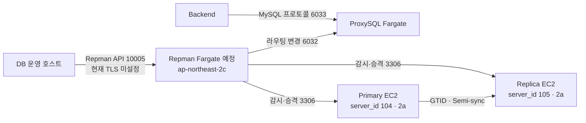

# MySQL 장애 복구 초기 설정 가이드

이 문서는 기존 MySQL Primary/Replica 구성에 Semi-sync를 켜고, Replication Manager(Repman)를 Fargate에 올려 ProxySQL과 연동하기 위한 초기 설정 순서와 현재 확인된 상태를 기록한다.

> 확인 기준일: 2026-11-16 (한국 시간)
>
> 이 문서 작업 중 내가 Terraform 적용, ECS 배포, FIS 실험을 직접 실행하지는 않았다. 다만 PR #333이 `main`에 병합된 뒤 GitHub Actions 자동 적용이 실행됐고, ECS 단계는 실패해 일부 지원 리소스만 남았다. 현재 코드와 AWS 실제 상태를 구분해서 읽는다.

관련 문서:

- [DB 장애 주입 및 실험 설계](README.md)
- [Semi-sync 설정 스크립트](../../app-server/db-migration/semisync/configure_semisync.sh)
- [Repman 계정 준비 스크립트](../../app-server/db-migration/semisync/configure_repman_accounts.sh)
- [Repman ECS 구성](../../ecs/svc_repman.tf)
- [ProxySQL ECS 구성](../../ecs/svc_proxysql.tf)
- [계획 전환 운영 절차](../../app-server/db-migration/switchover/RUNBOOK.md)

## 구성 개요



현재 두 DB 노드는 모두 `ap-northeast-2a`에 있다. Repman Terraform은 두 DB와 다른 AZ의 private subnet을 선택하도록 작성돼 있고, 현재 VPC에는 `ap-northeast-2c` private subnet이 있다. 따라서 적용 시 Repman은 `2c`에 배치될 수 있지만, DB 두 대가 `2a`에 모여 있으므로 AZ 장애 복구가 되는 구성은 아니다.

Repman은 Backend 요청 경로에 들어가지 않는 제어 서비스다. DB를 감시하고 장애 시 승격을 수행한 뒤 ProxySQL Admin `6032`에 새 역할을 반영한다. Backend SQL은 계속 ProxySQL client port `6033`으로 들어온다. 현재 앱 계정의 기본 hostgroup은 writer `10`이므로, reader hostgroup `20`을 준비하는 것만으로 앱의 SELECT가 Replica로 분산되지는 않는다.

## 2026-11-16 실제 상태 확인

| 대상 | 현재 확인값 |
| --- | --- |
| Primary | EC2 `i-081a5f4798f592f49`, `10.0.1.217`, `ap-northeast-2a`, 실행 중, MySQL `server_id=104`, `read_only=0`, `super_read_only=0` |
| Replica | EC2 `i-09246a4ca3a6724e5`, `10.0.11.226`, `ap-northeast-2a`, 실행 중, MySQL `server_id=105`, `read_only=1`, `super_read_only=1` |
| 복제 | Replica의 연결 수신기와 적용기가 모두 `ON`; MySQL GTID 모드 `ON` |
| Semi-sync | Primary 플러그인 `ACTIVE`, source 상태 `ON`; Replica 플러그인 `ACTIVE`, replica 상태 `ON` |
| Repman 데이터베이스 준비 | 두 DB 모두 `replication_manager_schema`와 잠금되지 않은 `repman`·`repman_repl` 계정을 가짐 |
| ProxySQL ECS 서비스 | `ACTIVE`, desired/running 각각 1개, 현재 task definition revision `6`, ECS Exec 비활성화 |
| Repman ECS 서비스 | 현재 ECS cluster에 없음. Terraform 코드에만 준비됨 |
| Repman 배치 후보 | private subnet `2a`와 `2c` 확인. DB와 다른 AZ를 고르는 코드 조건에 따라 Repman 후보는 `2c` |

2026-11-16에 [Terraform 자동 적용 실행](https://github.com/100-hours-a-week/KTB4-11th-Cloud/actions/runs/43768146827)이 시작됐다. `app-server` root 적용은 완료됐고 `terraform_data.db_private_replica_bootstrap` 원격 bootstrap 절차도 다시 실행됐다. 이 과정에서 DB EC2를 교체하지는 않았다. 이어진 `ecs` root 적용은 `aws_efs_file_system.repman` 생성 중 적용 역할에 `elasticfilesystem:TagResource` 권한이 없어 실패했다.

실패 전 생성된 Repman 지원 리소스 중 현재 확인된 것은 두 보안 그룹(`sg-02a73bb684e847c76`, `sg-01ff866aa7187eb6f`), Cloud Map 서비스(`srv-vkglsi76osj3ph2n`), CloudWatch 로그 그룹, Repman IAM 역할이다. Repman EFS, task definition, ECS service는 없다. ProxySQL service는 기존 task definition revision `6`으로 계속 실행 중이다. 재적용 전에는 Terraform state와 이 부분 생성된 리소스가 일치하는지 확인해야 한다.

Semi-sync source의 현재 설정은 `rpl_semi_sync_source_timeout=10000`ms, `rpl_semi_sync_source_wait_for_replica_count=1`, `rpl_semi_sync_source_wait_point=AFTER_SYNC`다. 확인 시 source 상태는 `ON`이었다. Replica에서도 `rpl_semi_sync_replica_enabled=ON`, 상태 `ON`을 확인했다. SSM Parameter Store에서는 아래 파라미터의 이름과 `SecureString` 형식만 확인했으며, 비밀 값은 읽거나 기록하지 않았다.

| 파라미터 경로 | 용도 | 현재 확인 |
| --- | --- | --- |
| `/stockspoon/v2/prod/repman/MYSQL_PASSWORD` | 두 DB의 Repman 관리 계정 비밀번호 | `SecureString` 존재 |
| `/stockspoon/v2/prod/repman/API_PASSWORD` | Repman API `admin` 계정 비밀번호 | `SecureString` 존재 |
| `/stockspoon/v1/db-private-replica/replication-password` | Repman이 사용할 `repman_repl` 계정 비밀번호 | `SecureString` 존재 |
| `/stockspoon/v2/prod/proxysql/ADMIN_PASSWORD` | ProxySQL Admin 접속 비밀번호 | `SecureString` 존재 |
| `/stockspoon/v2/prod/backend/PROXYSQL_MONITOR_PASSWORD` | ProxySQL의 MySQL 모니터 계정 비밀번호 | `SecureString` 존재 |

이 확인은 DB에 SSM Run Command로 읽기 전용 SQL을 실행하고, ECS·EC2·SSM 리소스 메타데이터를 조회한 결과다. DB 상태는 조회 시점 이후 달라질 수 있으므로 실제 실험 전 다시 확인한다.

## 코드가 준비하는 설정

### Semi-sync

`configure_semisync.sh`는 호스트별 컨테이너 이름과 MySQL 역할을 확인한 다음 설치된 플러그인 상태와 `server_id`, GTID, 읽기 전용 값을 검증한다. 현재 설정 단계는 다음과 같다.

| 단계 | 대상 | 동작 |
| --- | --- | --- |
| `source-prepare` | Primary | `rpl_semi_sync_source` 플러그인을 설치하고 timeout 10초, Replica ACK 1개, `AFTER_SYNC`를 영속 설정한다. 이 단계에서는 source Semi-sync를 아직 켜지 않는다. |
| `replica-enable` | Replica | 복제 수신기·적용기가 정상인지 확인하고 `rpl_semi_sync_replica_enabled=ON`을 영속 설정한다. 필요하면 IO thread를 재시작해 Semi-sync 협상을 갱신한다. 실행 후 `read_only` 보호를 확인한다. |
| `source-enable` | Primary | 마지막 단계에서 `rpl_semi_sync_source_enabled=ON`을 영속 설정한다. |

순서를 지키는 이유는 Replica 플러그인이 준비되기 전에 Primary 쓰기를 Semi-sync 대기로 바꾸지 않기 위해서다. MySQL Semi-sync는 Replica가 변경 이벤트를 relay log에 기록하고 디스크에 flush한 뒤 ACK하는 방식이다. Replica에서 변경을 적용·커밋하는 것까지 Primary가 기다리는 완전 동기 복제는 아니다. 10초 안에 ACK가 오지 않으면 MySQL이 비동기 복제로 돌아갈 수 있으므로, 설정만으로 RPO 0을 보장한다고 보면 안 된다. 자세한 동작은 [MySQL 8.4 Semi-sync 문서](https://dev.mysql.com/doc/refman/8.4/en/replication-semisync.html)를 참고한다.

### Repman용 MySQL 계정

`configure_repman_accounts.sh`는 `source` 또는 `replica` 인수를 받는다. 두 노드 모두 MySQL `server_id`와 GTID 상태를 확인하며, Primary에서는 `read_only=0`·`super_read_only=0`, Replica에서는 둘 다 `1`인 경우에만 진행한다.

1. Primary에서 `replication_manager_schema`를 만든다. 이 스키마 생성은 binary log에 기록돼 Replica로 복제된다.
2. Primary와 Replica 각각에서 `repman`과 `repman_repl` 계정을 만든다. 사용자·권한 변경은 `SET SESSION sql_log_bin=0`으로 복제하지 않고 노드별로 구성한다.
3. Replica 스크립트는 스키마가 복제될 때까지 최대 5분 기다린다. 계정을 생성할 때만 `super_read_only`를 잠시 내리고, 종료 시 다시 켜졌는지 확인한다. `read_only`는 계속 유지한다.

현재 코드의 `repman` 계정은 서버 상태 조회와 failover 작업에 필요한 전역 권한 및 `replication_manager_schema` 권한을 가진다. `repman_repl`에는 `REPLICATION SLAVE` 권한을 준다. 두 계정의 host는 `%`로 설정하므로 실제 네트워크 접근은 DB 보안 그룹에서 Repman task로 제한한다. 권한을 더 줄일 때는 Repman이 감시·승격·복제 재설정 과정에서 실제로 사용하는 SQL을 확인한 뒤 검증한다.

### Repman Fargate와 ProxySQL

`ecs/svc_repman.tf`는 다음 리소스를 준비한다.

- rootless 이미지 `signal18/replication-manager:v3.1.48-rootless`를 사용하는 Fargate task와 desired count 1인 ECS service
- 암호화된 EFS와 Access Point를 통해 `/var/lib/replication-manager` 상태 보존
- CloudWatch Logs 그룹 `/ecs/stockspoon-v2-prod/repman`
- Cloud Map 이름 `repman.stockspoon-v2.internal`
- MySQL 두 노드에 대한 TCP `3306`, ProxySQL Admin `6032`, EFS `2049`, HTTPS `443` 네트워크 규칙
- DB 운영 호스트 보안 그룹에서만 접근을 허용하는 Repman API TCP `10005`
- SSM에서 DB 계정, 복제 계정, API 계정, ProxySQL Admin 비밀번호를 task 시작 때 주입

Repman은 `failover-mode="automatic"`, `failover-at-sync=true`, `failover-max-slave-delay=0`, `failover-limit=3`, `failover-time-limit=10`, `failover-readonly-state=true`, `failover-restart-unsafe=false`, `check-replication-state=true`, `autorejoin=true`로 구성돼 있다. 특히 `failover-at-sync=true`는 Repman이 Semi-sync SYNC 상태인 Replica가 없을 때 승격을 막을 수 있다. 이는 데이터 손실 위험을 낮추는 대신 장애 시 서비스 쓰기 복구를 지연하거나 승격하지 못하게 할 수 있다. 옵션 의미는 [Signal18 장애 조치 절차 문서](https://docs.signal18.io/architecture/failover-workflow)와 [장애 조치 FAQ](https://docs.signal18.io/faq/failover-switchover)를 참고한다.

ProxySQL task를 다시 만들 때 bootstrap은 양쪽 DB의 `read_only`를 확인해 writable 노드를 writer hostgroup `10`, 나머지를 reader hostgroup `20`에 둔다. Repman은 ProxySQL Admin `6032`에 접근해 hostgroup의 역할을 변경하도록 준비돼 있다. Repman bootstrap은 users, query rules, ProxySQL variables를 덮어쓰지 않는다. 애플리케이션의 기본 hostgroup은 writer `10`이므로 read routing은 별도 설계 대상이다.

## 안전한 적용 순서

Terraform 코드만 반영해도 Semi-sync 스크립트와 MySQL 계정 스크립트가 자동 실행되지는 않는다. ECS task가 시작돼야 Repman이 DB에 접속할 수 있으므로, 데이터베이스 사전 준비와 ProxySQL 접근 경로를 먼저 확인한다.

### 1. DB 사전 점검

각 실험·설정 작업 직전에 다음을 확인한다.

```sql
SELECT @@server_id, @@read_only, @@super_read_only, @@gtid_mode;
SHOW REPLICA STATUS;
SHOW GLOBAL VARIABLES LIKE 'rpl_semi_sync%';
SHOW GLOBAL STATUS LIKE 'Rpl_semi_sync%';
```

현재 Primary가 `server_id=104`, 읽기 전용 값 `0/0`이고 Replica가 `server_id=105`, 값 `1/1`인지 본다. Replica의 IO·SQL 상태, source UUID, 오류 번호와 복제 지연을 함께 확인한다. 역할이 예상과 다르거나 두 노드가 모두 writable이면 다음 단계로 진행하지 않는다.

### 2. SSM 비밀과 권한 확인

- 위 표의 파라미터 경로가 정확하고 모두 `SecureString`인지 확인한다. 실제 값은 셸 출력, Terraform 변수, 명령행 인자, 로그에 넣지 않는다.
- `configure_repman_accounts.sh`는 Repman DB 비밀번호를 32~64자리 16진수, 복제 비밀번호를 16~32자리 16진수로 제한한다.
- ECS task 실행 역할은 task definition의 SSM secret을 읽어야 한다. 고객 관리형 KMS 키를 사용한다면 해당 키의 복호화 권한도 확인한다.
- API 비밀번호는 현재 코드에서 TOML 문자열에 직접 삽입되고 별도의 이스케이프가 없다. 인용 부호나 역슬래시가 없는 임의 16진수 비밀번호를 사용하거나, 적용 전에 문자열 이스케이프 처리를 추가한다.

### 3. MySQL에 Semi-sync와 계정 준비

코드 저장소의 스크립트는 AWS SSM Parameter Store와 각 DB 호스트의 Docker·MySQL root 비밀 파일을 사용한다. Terraform은 스크립트를 원격 호스트에 복사하거나 실행하지 않는다. 현재 저장소에는 이 스크립트 전달 자동화가 없으므로, 운영자는 승인된 전달 방법으로 두 호스트에 파일을 배치해야 한다. 아래 예시는 파일을 `/opt/stockspoon/db-migration/semisync/`에 복사했다고 가정한다. 비밀번호를 Run Command 명령 문자열에 직접 넣지 않는다.

Semi-sync는 다음 순서로 실행한다.

```bash
bash configure_semisync.sh source-prepare  # Primary에서
bash configure_semisync.sh replica-enable  # Replica에서
bash configure_semisync.sh source-enable   # Primary에서 마지막에
```

그 다음 Repman 계정 스크립트를 Primary, Replica 순서로 각각 실행한다.

```bash
bash configure_repman_accounts.sh source   # Primary에서
bash configure_repman_accounts.sh replica  # Replica에서
```

예를 들어 Primary에 준비한 파일을 실행할 때는 다음처럼 AWS Systems Manager Run Command를 사용한다. 각 단계에서 인스턴스 ID와 스크립트 인수만 해당 노드·단계에 맞게 바꾸고, 반환된 명령 ID의 실행 결과가 `Success`인지 확인한다.

```bash
aws ssm send-command \
  --region ap-northeast-2 \
  --instance-ids i-081a5f4798f592f49 \
  --document-name AWS-RunShellScript \
  --parameters 'commands=["bash /opt/stockspoon/db-migration/semisync/configure_semisync.sh source-prepare"]'
```

스크립트 재실행은 SSM 비밀 값과 DB 계정 비밀번호가 일치할 때만 한다. 계정 스크립트는 실행할 때마다 DB 계정 비밀번호를 SSM 값으로 다시 설정한다. SSM 값을 교체했다면 두 DB 계정과 ECS task가 같은 비밀번호를 사용하도록 회전 절차를 먼저 세운다.

### 4. ECS 변경 계획 검토

`ecs` Terraform root에서 plan을 만들고 다음을 확인한다.

- Repman Fargate service, task definition, EFS, Access Point, 보안 그룹, IAM, Cloud Map, 로그 그룹이 생성되는지
- ProxySQL task definition과 service가 의도한 새 revision으로 갱신되는지
- MySQL EC2, DB 데이터 볼륨, DB 보안 그룹에 교체·삭제·재시작 계획이 없는지
- Backend service와 Backend task definition이 바뀌지 않는지
- Repman subnet 후보가 DB 노드와 다른 AZ인 private subnet인지

**적용 순서 의존성 확인:** 현재 Repman service의 `depends_on`은 보안 그룹 규칙과 EFS mount target을 기다리지만, 새 ProxySQL ECS service revision의 안정화까지 명시적으로 기다리지는 않는다. 두 service를 한 번에 적용하면 Repman이 새 task의 Admin `6032` 준비 전에 시작할 수 있다. 적용 전에 코드에서 Repman service가 ProxySQL service에 의존하도록 하거나, 두 단계로 안전하게 배포할 절차를 정하고 첫 적용은 ProxySQL만 검증한 뒤 Repman을 시작한다. 이 순서 의존성을 해소하기 전에는 자동 failover 실험으로 넘어가지 않는다.

Repman service는 현재 코드에서 `enable_execute_command=true`다. ProxySQL service는 `enable_execute_command=false`이며, FIS 네트워크 주입 준비용 설정과 SSM agent sidecar를 포함한다. 현재 배포된 ProxySQL은 revision `6`이므로 새 ECS 설정이 실제 동작한다고 가정하지 않는다.

### 5. 배포 후 확인

배포 승인을 받은 뒤 ECS service가 steady state에 도달했는지, Repman task가 SSM 파라미터 주입·EFS mount·Cloud Map 등록에 성공했는지 확인한다. CloudWatch Logs에서 secret 값이 노출되지 않았는지도 확인한다.

Repman 화면/API에서 다음 상태를 확인한다.

1. 두 DB가 모두 등록됐고 실제 `server_id`, 역할이 Primary/Replica와 일치한다.
2. 복제 상태, Semi-sync 상태, Replica 지연 및 DB 오류가 정상이다.
3. ProxySQL에 접근할 수 있고 writer hostgroup `10`이 정확히 한 개의 writable 노드를 가리킨다.
4. 계획 전환을 먼저 실시해 ProxySQL writer 갱신, 이전 Primary의 Replica 재편입, 양쪽의 읽기 전용 보호가 동작한다.
5. 독립 DB probe와 ALB를 통과하는 서비스 probe가 각각 성공하고, 각각 별도 RTO를 기록한다.

Repman은 DB 운영 SG에서 TCP `10005`로만 접근할 수 있도록 되어 있다. 그러나 현재 task 정의에는 `monitoring-ssl-cert`와 `monitoring-ssl-key`가 설정·마운트되지 않았다. `api-https-bind=true`만으로 API 포트 TLS가 켜지는 것은 아니다. Signal18 문서는 인증서를 설정해야 `10005` API listener가 HTTPS가 된다고 설명한다. 현재 설정은 접근 범위가 SG로 제한된 내부 HTTP일 수 있으므로, 인증정보를 사용하기 전 인증서 구성 또는 명시적으로 승인된 TLS 종료 지점을 준비한다. 자세한 내용은 [Signal18 API 접속 문서](https://docs.signal18.io/installation/first-login)를 참고한다.

## 중단·복구 기준

- Repman이 예상하지 않은 DB를 writable로 만들거나 두 DB에서 `read_only=0`이 보이면 Backend 쓰기와 FIS 실험을 중단한다. 두 노드를 동시에 writable로 만들지 않는다.
- 승격 여부가 불확실하면 구 Primary를 먼저 격리하고 GTID, `SHOW REPLICA STATUS`, `read_only`, ProxySQL runtime hostgroup을 확인한다. 자동 복귀를 강제하지 않는다.
- Repman task만 시작하지 못한 경우 CloudWatch Logs와 ECS service event를 확인한다. 기존 DB 계정·스키마를 바로 삭제하거나 Semi-sync를 끄지 않는다.
- Semi-sync를 되돌려야 하면 먼저 장애 조치가 완료되어 단일 writable Primary를 확인하고, 변경 승인 후 현재 Primary에서 `SET PERSIST rpl_semi_sync_source_enabled=OFF`, 현재 Replica에서 `SET PERSIST rpl_semi_sync_replica_enabled=OFF`를 각각 실행한다. 플러그인 제거는 별도 점검 없이 하지 않는다.
- Repman을 내리기 전에는 Repman failover가 비활성인지, ProxySQL writer가 현재 Primary를 향하는지, 양쪽 DB의 역할과 복제 방향이 일치하는지 확인한다.

## 장애 실험으로 넘어가기 전 제한 사항

1. 두 DB가 같은 AZ에 있으므로 DB AZ 장애를 복구하는 구성이 아니다.
2. Repman은 desired count 1이며 별도 arbitrator/witness 구성은 코드에서 확인되지 않았다. Fargate task 한 개의 재시작은 Repman 제어면의 고가용성을 뜻하지 않는다.
3. `failover-at-sync=true`는 Semi-sync가 SYNC가 아니면 가용성보다 데이터 안전성을 우선해 승격을 막을 수 있다. 그 때의 RTO/RPO 기준과 운영자 개입 절차를 정해야 한다.
4. Semi-sync ACK는 Replica의 relay log 수신·기록 확인이지, 모든 장애와 async fallback에서 데이터 손실이 없다는 보장이 아니다.
5. 현재 FIS 템플릿은 Terraform state의 `db_migration_host` EC2 ID를 대상으로 한다. Repman이 역할만 바꿔도 Terraform 출력의 EC2 ID는 바뀌지 않으므로, 실험 직전 현재 Primary와 FIS target이 같은지 반드시 대조한다.
6. FIS는 장애를 주입할 뿐 RTO/RPO를 계산하지 않는다. RTO probe와 성공 처리 기준, 성공 응답을 받은 고유 쓰기 마커의 외부 기록·대조를 준비한 뒤 [DB 장애 주입 및 실험 설계](README.md)를 따른다.

## 참고 자료

- [MySQL 8.4 Semi-sync 복제](https://dev.mysql.com/doc/refman/8.4/en/replication-semisync.html)
- [MySQL 8.4 Semi-sync 설정 변수](https://dev.mysql.com/doc/refman/8.4/en/replication-semisync-interface.html)
- [Signal18 장애 조치 절차](https://docs.signal18.io/architecture/failover-workflow)
- [Signal18 장애 조치 및 전환 FAQ](https://docs.signal18.io/faq/failover-switchover)
- [Signal18 API 접속과 TLS 설정](https://docs.signal18.io/installation/first-login)
- [Signal18 Docker 설치 및 rootless 이미지](https://docs.signal18.io/installation/setup-instructions/docker)
